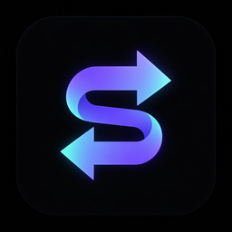
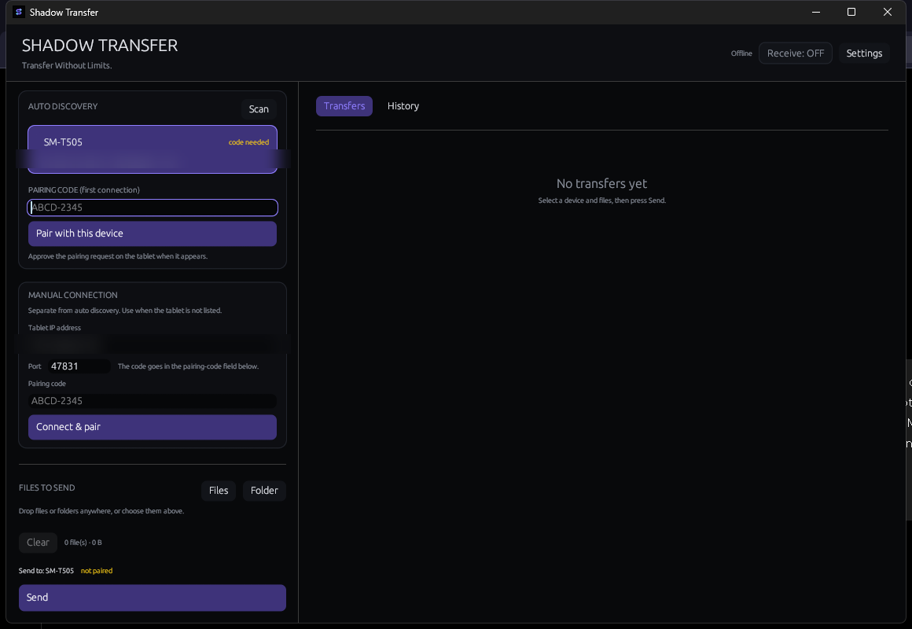
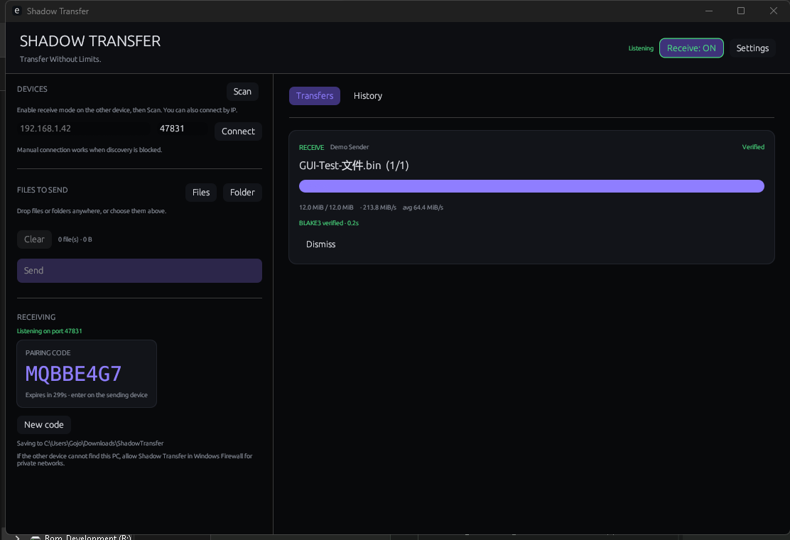
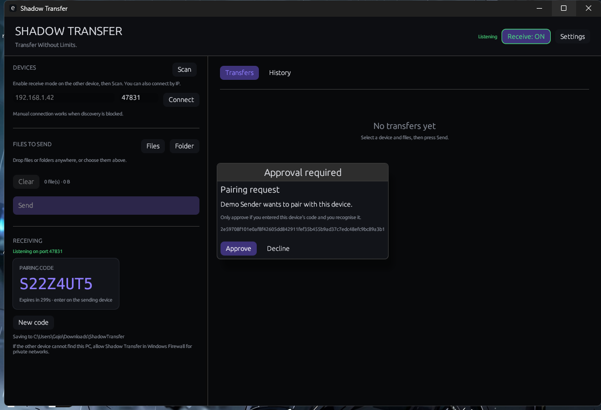
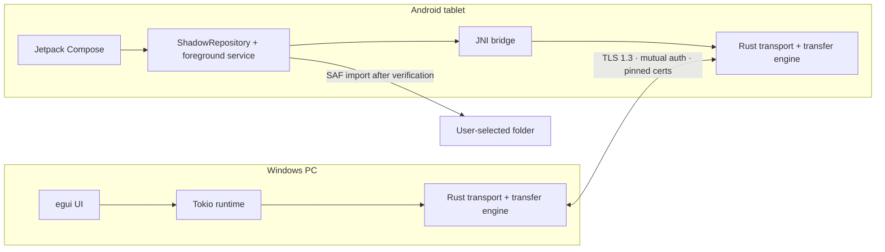

<div align="center">



# Shadow Transfer

**Transfer Without Limits.**

A secure, direct, local-network file transfer app for **Windows** and **Android**, powered by one shared **Rust** engine.

No cloud · No accounts · No telemetry · No mandatory internet

[](https://github.com/b7662777-hash/shadow-transfer/actions/workflows/ci.yml)
[](LICENSE)


[Download v0.1.0](https://github.com/b7662777-hash/shadow-transfer/releases/latest) · [Documentation](docs) · [Report a bug](https://github.com/b7662777-hash/shadow-transfer/issues/new?template=bug_report.yml) · [Security](SECURITY.md)

</div>

---

## Why Shadow Transfer

Most “easy” file transfer tools route your data through a cloud service or require an account. Shadow Transfer does neither. It finds the other device on your LAN, establishes a mutually authenticated **TLS 1.3** session, streams the files, and verifies them with **BLAKE3** — all locally.

The same Rust protocol, crypto, streaming and resume engine runs on both platforms. The Windows app is native `egui`; the Android app is Kotlin/Compose with the Rust engine behind JNI.

## Status

| Component | State |
|---|---|
| Shared Rust core | Built · 47 automated tests · `fmt` and `clippy -D warnings` clean |
| Windows app | Release EXE, portable ZIP and installer · GUI transfers verified |
| Android app | Debug and release APKs (arm64, armv7, x86_64) · installed and used on a Samsung Galaxy Tab A7 (SM-T505) |
| Real-device transfer | Windows → SM-T505: 449 MB and 1.845 GB files completed and BLAKE3-verified |
| Real Wi-Fi throughput | ~15 MB/s on the test 5 GHz link (link-bound; latency spikes observed) |
| Latest speed-tuning build | Built; awaits a repeat transfer on the tablet |
| Automated Android device tests | Not yet |

> **Honest note:** this is an early `0.1.0` release. The core flows are real and tested, but there is no Play Store signing setup, the binaries are unsigned, and Android identity keys are not yet Keystore-wrapped. See [Known limitations](#known-limitations).

## Features

- **TLS 1.3 only** — mutual certificates, ALPN, no plaintext fallback.
- **Certificate pinning** — device identity is a SHA-256 certificate fingerprint stored in a strict trust store.
- **Secure pairing** — one-time 8-character code (about 40 bits), BLAKE3 keyed proof bound to both fingerprints and nonces, 5-minute expiry, single use, explicit approval, rate limiting.
- **Streaming engine** — bounded memory, backpressure, adaptive 256 KiB–4 MiB chunks, no full-file buffering.
- **Integrity first** — per-chunk BLAKE3 plus full-file BLAKE3; the receiver independently verifies before reporting success.
- **Resume** — restarts from a verified prefix after cancellation or connection loss; files completed earlier are revalidated before being skipped.
- **Files and folders** — nested paths, Unicode names, collision-safe naming, never silent overwrite.
- **Cancellation** — from either sender or receiver.
- **LAN discovery** — short UDP broadcast windows while receiving, plus manual IP; no cloud relay, no port forwarding.
- **Windows UI** — auto/manual connection cards, dedicated pairing action, drag-and-drop, queue, live speed/ETA, history, settings, receive mode.
- **Android UI** — Compose, AMOLED dark theme, SAF destination import, foreground data-sync service, pairing countdown, approvals, discovery/manual sending.
- **Transfer tuning** — 8 MiB TCP buffers, incremental verification for fresh files, transfer-only Android Wi-Fi performance lock.

## Screenshots

| Connect and pair | Receive and verify | Approval |
|---|---|---|
|  |  |  |

## How it works



A transfer is one authenticated control session. The sender streams length-prefixed chunks; the receiver validates each chunk, writes to a private partial file, flushes, verifies the full BLAKE3 hash, and only then finalizes a collision-free destination name. Pairing and transfer requests require explicit approval on the receiving device.

- Protocol: [docs/PROTOCOL.md](docs/PROTOCOL.md)
- Architecture and decisions: [docs/ARCHITECTURE.md](docs/ARCHITECTURE.md)
- Security model: [docs/SECURITY.md](docs/SECURITY.md)

## Download and install

Get the latest release from the [Releases page](https://github.com/b7662777-hash/shadow-transfer/releases/latest).

### Windows

- **Installer:** `ShadowTransfer-Setup.exe` (per-user, unsigned)
- **Portable:** `ShadowTransfer.exe` or the portable ZIP
- **Requirements:** Windows 10/11 x64; both devices on the same LAN
- Allow Shadow Transfer on **private networks** in Windows Firewall.

### Android

- **APK:** `ShadowTransfer-0.1.0-release.apk` (signed with a local project key; not a Play Store build)
- **Minimum:** Android 8.0 (API 26); three major ABIs are packaged.

```bash
adb install -r ShadowTransfer-0.1.0-release.apk
```

## Pairing and sending

Pairing is a standalone step; it does not require choosing files.

1. **On the receiver** (tablet for Windows → Android): enable **Receive** and note the 8-character code.
2. **On the sender:** wait for the startup scan, then:
   - **AUTO DISCOVERY:** select the device, enter the code in that card, and press **Pair with this device**; or
   - **MANUAL CONNECTION:** enter the receiver IP, port `47831`, and its own code field, then **Connect & pair**.
3. **Approve on the receiver** when the pairing request appears. The badge changes from **code needed** to **trusted**.
4. Select files or folders, confirm **Send to: `<device> paired`**, press **Send**, and approve the incoming transfer on the receiver.
5. A file is shown as **Verified** only after the receiver acknowledges its own BLAKE3 verification.

Manual IP works when discovery is blocked by a firewall or client-isolated Wi-Fi. The receiver port is always `47831`.

## Performance

Loopback on the development machine (includes TLS, framing, disk I/O and BLAKE3 verification):

| Transfer | Result |
|---|---|
| 5 GiB | **324.9 MiB/s** after tuning (228.8 before) |
| 1 GiB | 284–376 MiB/s |
| 100 MiB | ~400–490 MiB/s after tuning |
| Raw TCP loopback, no TLS/hash/disk | ~1088–1294 MiB/s |
| BLAKE3 (4 MiB buffer) | ~4.1 GiB/s |

Real-world Wi-Fi: **~15 MB/s (~120 Mbps)** on the test 5 GHz link, with latency spikes up to 279 ms. Single-stream throughput on Wi-Fi is limited by TCP window, airtime, power save and signal quality. 1.7 GB in “seconds” would require more than 1.4 Gbps and is not realistic for this tablet class.

Speed tuning applied: 8 MiB TCP buffers, incremental verification for fresh files, and a transfer-only high-performance Wi-Fi lock on Android. See [docs/PERFORMANCE.md](docs/PERFORMANCE.md) and [speed troubleshooting](docs/TROUBLESHOOTING.md#transfers-are-slow).

## Security

- TLS 1.3 only; rustls with the `ring` provider; client certificates mandatory.
- Self-signed device certificates are pinned by SHA-256 fingerprint at the application layer before any message is processed.
- Pairing uses a keyed BLAKE3 proof over both certificate fingerprints and both nonces; short numeric PINs are not used as the sole mechanism.
- Protocol frames and messages are bounded and strictly validated; paths reject traversal, reserved names and illegal characters.
- Files are finalized only after integrity verification; received files are never executed.
- No telemetry and no cloud dependency.

**Known limitations:** Android identity storage is app-private rather than Keystore-wrapped; Windows identity storage is user-profile protected rather than DPAPI-wrapped; the EXE/installer are unsigned; the release APK uses a local signing key. See [docs/SECURITY.md](docs/SECURITY.md).

## Build from source

Prerequisites: Rust stable, MSVC 2022 (Windows), JDK 17, Android SDK 34, NDK 26.1.10909125, the included Gradle wrapper, and `cargo-ndk`.

```bash
# quality gates
cargo fmt --all -- --check
cargo clippy --workspace --all-targets -- -D warnings
cargo test --workspace

# Windows release
cargo build --release -p shadow-windows

# Android native libraries
cd apps/android/rust
cargo ndk -t arm64-v8a -t armeabi-v7a -t x86_64 \
  -o ../app/src/main/jniLibs --platform 26 build --release -p shadow-android

# APKs
cd ..
./gradlew :app:assembleDebug :app:assembleRelease
```

Windows packaging scripts live in [`scripts/`](scripts); Android details and signing are in [docs/BUILD.md](docs/BUILD.md).

## Testing

```bash
cargo test --workspace
```

The suite contains **47 tests**, including real TCP/TLS/filesystem end-to-end tests:

- paired transfer with folders, Unicode names and empty files;
- wrong code, missing code, declined approvals;
- cancellation followed by verified resume;
- standalone pairing followed by a code-free send;
- raw-client path traversal and corrupt chunk rejection;
- source-change detection;
- trust reuse and source identity checks.

See [docs/TESTING.md](docs/TESTING.md) for the full inventory and hardware test status.

## Repository layout

```
Shadow-Transfer/
├── crates/
│   ├── shadow-protocol/     bounded framing + versioned messages
│   ├── shadow-crypto/       identity, TLS 1.3, pairing, trust store
│   ├── shadow-transfer/     sessions, sender, receiver, resume, progress
│   └── shadow-discovery/    UDP beacons and discovery windows
├── apps/
│   ├── windows/             egui app, assets, Inno Setup script
│   └── android/             Gradle project, Compose UI, Rust JNI crate
├── tests/e2e/               real-socket integration tests
├── docs/                    architecture, protocol, security, build, testing
├── scripts/                 build, installer and benchmark helpers
└── .github/                 CI, Android build workflow, templates, dependabot
```

## Documentation

| Document | Contents |
|---|---|
| [Architecture](docs/ARCHITECTURE.md) | crates, threading, resume state, platform integration |
| [Protocol](docs/PROTOCOL.md) | framing, message catalog, validation, state machines |
| [Security](docs/SECURITY.md) | threat model, pinning, pairing proof, file safety |
| [Networking](docs/NETWORKING.md) | ports, discovery, timeouts, Android permissions |
| [Windows](docs/WINDOWS.md) | UI flows, data locations, installer, debug hooks |
| [Android](docs/ANDROID.md) | JNI architecture, SAF, foreground service, limitations |
| [Build](docs/BUILD.md) | toolchain, commands, packaging, signing |
| [Testing](docs/TESTING.md) | test inventory, E2E scenarios, hardware status |
| [Performance](docs/PERFORMANCE.md) | measured results, tuning, realistic expectations |
| [Troubleshooting](docs/TROUBLESHOOTING.md) | discovery, pairing, storage, speed, builds |

## Known limitations

- No Android Keystore or Windows DPAPI wrapping for identity keys yet.
- No Play Store signing and no code-signing certificates for Windows binaries.
- IPv4 LAN only; manual IP is required if broadcast discovery is blocked.
- Pairing uses a secure code, not QR yet.
- No compression, QUIC, parallel streams, or cloud/NAT traversal by design.
- Automated tests run on the host; physical Android testing is manual.
- Real-world throughput is governed by Wi-Fi, power saving and storage; see [PERFORMANCE.md](docs/PERFORMANCE.md).

## Contributing

Issues and focused pull requests are welcome. Read [CONTRIBUTING.md](CONTRIBUTING.md) and [CODE_OF_CONDUCT.md](CODE_OF_CONDUCT.md) first. Security reports must be private: [SECURITY.md](SECURITY.md).

## License

[MIT](LICENSE) © Shadow Transfer Contributors
